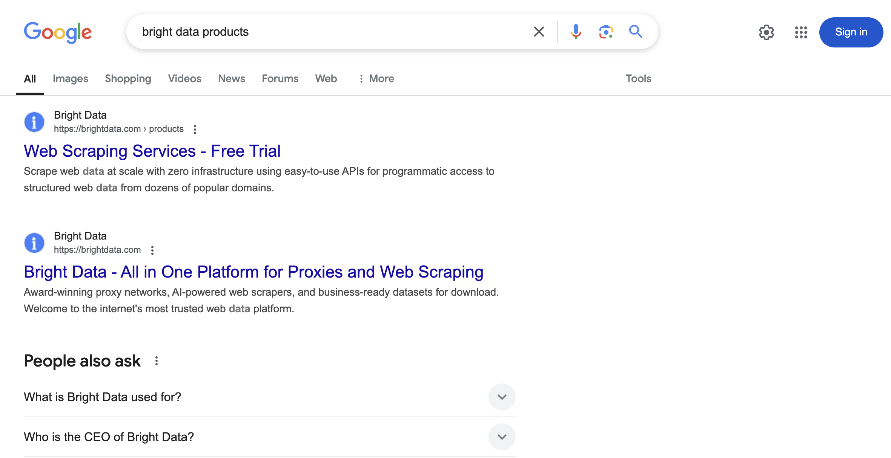
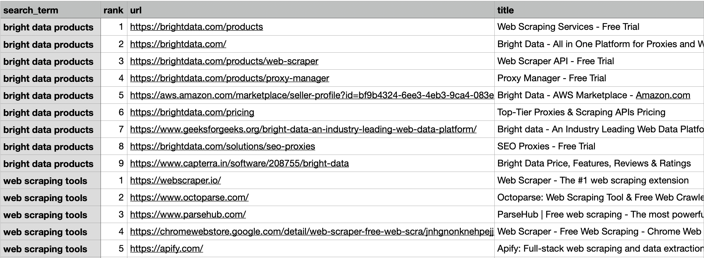

# 搜索引擎 API

[](https://www.bright.cn/products/serp-api) 

此代码库提供两种采集搜索引擎结果页面（SERP）数据的方法：
1. 适用于基础数据采集的免费小规模 Google 抓取工具
2. 用于从主流搜索引擎大规模实时采集数据的企业级 API 解决方案

## 目录
- [免费 SERP 抓取工具](#免费-serp-抓取工具)
   - [输入参数](#输入参数)
   - [实现方式](#实现方式)
   - [示例输出](#示例输出)
- [限制](#限制)
- [Bright Data 搜索引擎 API](#bright-data-搜索引擎-api)
   - [主要功能](#主要功能)
   - [快速入门](#快速入门)
   - [直接访问 API](#直接访问-api)
   - [原生代理访问](#原生代理访问)
- [查询参数概览](#查询参数概览)
   - [Google](#google)
     - [Google 搜索](#1-google-搜索)
     - [Google 地图](#2-google-地图)
     - [Google 趋势](#3-google-趋势)
     - [Google 评论](#4-google-评论)
     - [Google Lens](#5-google-lens)
     - [Google 酒店](#6-google-酒店)
     - [Google 航班](#7-google-航班)
   - [Bing](#bing)
   - [Yandex](#yandex)
   - [DuckDuckGo](#duckduckgo)
- [搜索引擎 API 的其他设置](#搜索引擎-api-的其他设置)
   - [异步请求](#异步请求)
   - [多查询请求](#多查询请求)
- [支持与资源](#支持与资源)

## 免费 SERP 抓取工具
[免费抓取工具](https://github.com/bright-cn/serp-api/tree/main/free_serp_scraper)支持小规模采集 Google SERP 数据。




### 输入参数
- **文件：** 包含搜索词的文本文件（必需）
- **格式：** 每行一个搜索词

### 实现方式
在 Python 文件中修改以下参数：
```python
# free_serp_scraper/google_serp.py
HEADLESS = False
MAX_RETRIES = 2
REQUEST_DELAY = (1, 4)

with open("search_terms.txt", "r", encoding="utf-8") as file:
    pass
```

### 示例输出



## 限制
Google 实施了多种反爬虫措施：

1. **验证码**：用于区分真人与机器人
2. **IP 封禁**：对可疑活动实施临时或永久封禁
3. **速率限制**：快速检测并阻止身份不明的请求
4. **地理位置定向**：结果会因位置、语言和设备而异
5. **蜜罐陷阱**：通过隐藏元素检测自动访问

## Bright Data 搜索引擎 API
[Bright Data 的搜索引擎 API](https://www.bright.cn/products/serp-api)为可靠采集 SERP 数据提供了强大的解决方案。

### 主要功能

- 按成功请求付费模式
- 响应速度快
- 特定位置定向
- 支持多种设备类型和搜索参数
- 覆盖主流搜索引擎（Google、Bing、DuckDuckGo、Yandex、百度、Yahoo、Naver）
- 内置反机器人解决方案
- 提供城市级精度的实时结果
- 结构化数据输出（JSON/HTML）

**注意：** **搜索引擎 API** 是 [**Bright Data 网页爬虫套件**](https://docs.brightdata.com/scraping-automation/introduction)的一部分，具备完整的代理管理、解锁和解析功能。

### 快速入门

1. **前提条件：**
    - 创建 [Bright Data 账户](https://www.bright.cn/)
    - 获取你的 [API 密钥](https://docs.brightdata.com/general/account/api-token)
2. **设置搜索引擎 API：** 按照[分步指南](https://github.com/bright-cn/serp-api/blob/main/setup_serp_api.md)，在你的 Bright Data 账户中设置新的搜索引擎 API。
3. **实现方法：**
    1. 直接访问 API
    2. 原生代理访问

### 直接访问 API
使用该 API 最简单的方法是直接发起请求。

**cURL 示例**
```bash
curl https://api.brightdata.com/request \
  -H "Content-Type: application/json" \
  -H "Authorization: Bearer API_TOKEN" \
  -d '{
        "zone": "ZONE_NAME",
        "url": "https://www.google.com/search?q=ollama&brd_json=1",
        "format": "raw"
      }'
```

**Python 示例**
```python
import requests
import json

url = "https://api.brightdata.com/request"

headers = {"Content-Type": "application/json", "Authorization": "Bearer API_TOKEN"}

payload = {
    "zone": "ZONE_NAME",
    "url": "https://www.google.com/search?q=ollama&brd_json=1",
    "format": "raw",
}

response = requests.post(url, headers=headers, json=payload)

with open("serp_direct_api.json", "w") as file:
    json.dump(response.json(), file, indent=4)

print("Response saved to 'serp_direct_api.json'.")
```

👉 查看[完整 JSON 输出](https://github.com/bright-cn/serp-api/blob/main/serp_api_outputs/serp_direct_api.json)

**注意**：使用 `brd_json=1` 获取解析后的 JSON，或使用 `brd_json=html` 获取解析后的 JSON 和完整嵌套 HTML。

详细了解如何解析结果：[搜索引擎 API 解析指南](https://docs.brightdata.com/scraping-automation/serp-api/parsing-search-results)

### 原生代理访问
使用代理路由的替代方法。

**cURL 示例**
```bash
curl -i \
  --proxy brd.superproxy.io:33335 \
  --proxy-user brd-customer-<CUSTOMER_ID>-zone-<ZONE_NAME>:<ZONE_PASSWORD> \
  -k \
  "https://www.google.com/search?q=ollama"
```

**Python 示例**
```python
import requests
import urllib3

urllib3.disable_warnings(urllib3.exceptions.InsecureRequestWarning)

host = "brd.superproxy.io"
port = 33335
username = "brd-customer-<customer_id>-zone-<zone_name>"
password = "<zone_password>"
proxy_url = f"http://{username}:{password}@{host}:{port}"

proxies = {"http": proxy_url, "https": proxy_url}

url = "https://www.google.com/search?q=ollama"
response = requests.get(url, proxies=proxies, verify=False)

with open("serp_native_proxy.html", "w", encoding="utf-8") as file:
    file.write(response.text)

print("Response saved to 'serp_native_proxy.html'.")
```

👉 查看[完整 HTML 输出](https://github.com/bright-cn/serp-api/blob/main/serp_api_outputs/serp_native_proxy.html)

**SSL 证书**：在生产环境中加载 Bright Data 的 SSL 证书。了解详情：[SSL 证书指南](https://docs.brightdata.com/general/account/ssl-certificate)

## 查询参数概览
Bright Data 搜索引擎 API 允许你使用本地化、分页、设备模拟等查询参数，为 Google、Bing、Yandex 和 DuckDuckGo 等多个搜索引擎自定义请求。本概览将从整体上介绍该 API 的功能。

> 如需查看所有查询参数的完整列表和详细说明，请参阅[详细查询参数文档](https://docs.brightdata.com/scraping-automation/serp-api/query-parameters)。

### Google
搜索引擎 API 支持多种 Google 服务，包括 [**搜索**](https://www.bright.cn/products/serp-api/google-search)、[**地图**](https://www.bright.cn/products/web-scraper/google-maps)、[**趋势**](https://www.bright.cn/products/serp-api/google-search/trends)、[**评论**](https://www.bright.cn/products/serp-api/google-search/reviews)、**Lens**、[**酒店**](https://www.bright.cn/products/web-scraper/google-hotels)和[**航班**](https://www.bright.cn/products/web-scraper/google-flights)。以下是各项服务的主要配置参数：

#### 1. Google 搜索
使用本地化、搜索类型、分页、地理位置和设备定向选项自定义搜索结果。

**本地化**
- `gl`：搜索位置的国家/地区代码（例如 `gl=us`）。
- `hl`：结果的语言代码（例如 `hl=en`）。

```bash
curl \
  --proxy brd.superproxy.io:33335 \
  --proxy-user brd-customer-<customer-id>-zone-<zone-name>:<zone-password> \
  "https://www.google.com/search?q=pizza&gl=us&hl=en"
```

**搜索类型：** 使用 **`tbm`** 参数指定搜索类型：

- 图片：`tbm=isch`
- 购物：`tbm=shop`
- 新闻：`tbm=nws`
- 视频：`tbm=vid`

```bash
curl \
  --proxy brd.superproxy.io:33335 \
  --proxy-user brd-customer-<customer-id>-zone-<zone-name>:<zone-password> \
  "https://www.google.com/search?q=pizza&tbm=shop"
```

**分页：**
- `start`：结果偏移量（第一页为 0，第二页为 20，以此类推）。
- `num`：每页结果数（默认为 20）。

```bash
curl \
  --proxy brd.superproxy.io:33335 \
  --proxy-user brd-customer-<customer-id>-zone-<zone-name>:<zone-password> \
  "https://www.google.com/search?q=pizza&start=20&num=50"
```

**地理位置：**
- `uule`：用于获取特定地理位置结果的编码位置字符串

```bash
curl \
  --proxy brd.superproxy.io:33335 \
  --proxy-user brd-customer-<customer-id>-zone-<zone-name>:<zone-password> \
  "https://www.google.com/search?q=pizza&uule=w+CAIQICINVW5pdGVkK1N0YXRlcw"
```

**设备定向：** 使用 **`brd_mobile`** 参数：

- `0`：桌面设备（默认）
- `1`：随机移动设备
- 特定值：`ios`（或 `iphone`）、`ipad`、`android`、`android_tablet`

```bash
curl \
  --proxy brd.superproxy.io:33335 \
  --proxy-user brd-customer-<customer-id>-zone-<zone-name>:<zone-password> \
  "https://www.google.com/search?q=pizza&brd_mobile=1"
```

#### 2. Google 地图
通过指定坐标并按住宿类型筛选，自定义地图查询。

**坐标：**
- 格式：`@latitude,longitude,zoom`（例如，缩放级别从 `3z` 到 `21z`）。

```bash
curl \
  --proxy brd.superproxy.io:33335 \
  --proxy-user brd-customer-<customer-id>-zone-<zone-name>:<zone-password> \
  "https://www.google.com/maps/search/restaurants/@47.30227,1.67458,14.00z"
```

**住宿搜索：**

- `brd_accomodation_type`:
    - `hotels`（默认）
    - `vacation_rentals`

```bash
curl \
  --proxy brd.superproxy.io:33335 \
  --proxy-user brd-customer-<customer-id>-zone-<zone-name>:<zone-password> \
  "https://www.google.com/maps/search/hotels+new+york/?brd_accomodation_type=vacation_rentals"
```

#### 3. Google 趋势
使用可自定义的时间范围和组件选项检索趋势数据。

**必需参数：**

- `brd_json=1`：返回解析后的 JSON 结果。
- `brd_trends`：指定组件（例如 `timeseries,geo_map`）。

**时间范围：**

- `date`：定义时间范围（例如，`now 1-d` 表示过去一天）。

```bash
curl \
  --proxy brd.superproxy.io:33335 \
  --proxy-user brd-customer-<customer-id>-zone-<zone-name>:<zone-password> \
  "https://trends.google.com/trends/explore?q=pizza&date=now+1-d&brd_trends=timeseries,geo_map&brd_json=1"
```

#### 4. Google 评论
使用功能 ID 获取评论，并根据需要排序。

**主要参数：**

- `fid`：搜索结果中的功能 ID。
- `sort`：排序顺序（例如 `newestFirst`、`ratingHigh`）。

```bash
curl \
  --proxy brd.superproxy.io:33335 \
  --proxy-user "brd-customer-<id>-zone-<name>:<pass>" \
  "https://www.google.com/reviews?fid=0x808fba02425dad8f&sort=newestFirst"
```

#### 5. Google Lens
使用 URL 或上传文件按图片搜索。

**图片搜索：**

- `url`：要搜索的图片 URL。
- `brd_json=1`：以 JSON 格式返回结果。

```bash
curl \
  --proxy brd.superproxy.io:33335 \
  --proxy-user brd-customer-<customer-id>-zone-<zone-name>:<zone-password> \
  "https://lens.google.com/uploadbyurl?url=https://example.com/image.jpg&brd_json=1"
```

#### 6. Google 酒店
使用预订日期和货币选项自定义酒店搜索。

**预订参数：**

- `brd_dates`：入住和退房日期（`YYYY-MM-DD,YYYY-MM-DD`）。
- `brd_currency`：货币代码（例如 `USD`、`EUR`）。

```bash
curl \
  --proxy brd.superproxy.io:33335 \
  --proxy-user brd-customer-<customer-id>-zone-<zone-name>:<zone-password> \
  "https://www.google.com/travel/hotels?q=hotels+new+york&brd_dates=2022-01-20,2022-02-05"
```

#### 7. Google 航班
使用类似的本地化参数搜索航班。

```bash
curl \
  --proxy brd.superproxy.io:33335 \
  --proxy-user brd-customer-<customer-id>-zone-<zone-name>:<zone-password> \
  "https://www.google.com/travel/flights?q=flights+new+york&gl=us&hl=en"
```


### Bing
使用本地化、地理位置定向、分页、设备与浏览器定向以及输出格式等选项配置 Bing 查询。查看[专用 Bing API](https://www.bright.cn/products/serp-api/bing-search)。

**本地化**

- `setLang`：界面语言（例如 `setLang=en-US`）。

```bash
curl \
  --proxy brd.superproxy.io:33335 \
  --proxy-user brd-customer-<customer-id>-zone-<zone-name>:<zone-password> \
  "https://www.bing.com/search?q=pizza&setLang=en-US"
```

**地理位置**

- `location`：搜索来源地（例如 `location=New+York`）。
- `cc`：国家/地区代码（例如 `cc=us`）。
- `mkt`：市场代码（例如 `mkt=en-US`）。


```bash
curl \
  --proxy brd.superproxy.io:33335 \
  --proxy-user brd-customer-<customer-id>-zone-<zone-name>:<zone-password> \
  "https://www.bing.com/search?q=pizza&location=New+York&cc=us&mkt=en-US"
```

**分页**

- `count`：结果数量（例如 `count=50`）。
- `first`：分页偏移量（例如，第二页使用 `first=11`）。


```bash
curl \
  --proxy brd.superproxy.io:33335 \
  --proxy-user brd-customer-<customer-id>-zone-<zone-name>:<zone-password> \
  "https://www.bing.com/search?q=pizza&count=50&first=11"
```

**筛选条件**

- `safesearch`：成人内容筛选（例如 `safesearch=off`）。

```bash
curl \
  --proxy brd.superproxy.io:33335 \
  --proxy-user brd-customer-<customer-id>-zone-<zone-name>:<zone-password> \
  "https://www.bing.com/search?q=pizza&safesearch=off"
```

**设备定向**

- `brd_mobile`：指定设备类型（例如，移动设备使用 `brd_mobile=1`，或使用 `brd_mobile=ios`）。

```bash
curl \
  --proxy brd.superproxy.io:33335 \
  --proxy-user brd-customer-<customer-id>-zone-<zone-name>:<zone-password> \
  "https://www.bing.com/search?q=pizza&brd_mobile=1"
```

**浏览器定向**

- `brd_browser`：指定浏览器（例如 `brd_browser=chrome`）。

```bash
curl \
  --proxy brd.superproxy.io:33335 \
  --proxy-user brd-customer-<customer-id>-zone-<zone-name>:<zone-password> \
  "https://www.bing.com/search?q=pizza&brd_browser=chrome"
```

**解析**

- `brd_json`：返回解析后的 JSON（例如 `brd_json=1`）。

```bash
curl \
  --proxy brd.superproxy.io:33335 \
  --proxy-user brd-customer-<customer-id>-zone-<zone-name>:<zone-password> \
  "https://www.bing.com/search?q=pizza&brd_json=1"
```

### Yandex
使用本地化、分页、时间范围以及设备/浏览器定向参数快速配置 Yandex 查询。查看[专用 Yandex API](https://www.bright.cn/products/serp-api/yandex-search)。

**本地化**
- `lr`：指定地区（例如，`lr=84` 表示美国）。
- `lang`：页面语言（例如 `lang=en`）。

```bash
curl \
  --proxy brd.superproxy.io:33335 \
  --proxy-user brd-customer-<customer-id>-zone-<zone-name>:<zone-password> \
  "https://www.yandex.com/search/?text=pizza&lr=84&lang=en"
```

**分页**
- `p`：结果页码（例如，第二页使用 `p=2`）。

```bash
curl \
  --proxy brd.superproxy.io:33335 \
  --proxy-user brd-customer-<customer-id>-zone-<zone-name>:<zone-password> \
  "https://www.yandex.com/search/?text=pizza&p=2"
```

**时间范围**
- `within`：指定时间范围（例如 `within=1`）。

```bash
curl \
  --proxy brd.superproxy.io:33335 \
  --proxy-user brd-customer-<customer-id>-zone-<zone-name>:<zone-password> \
  "https://www.yandex.com/search/?text=pizza&within=1"
```

**设备定向**
```bash
curl \
  --proxy brd.superproxy.io:33335 \
  --proxy-user brd-customer-<customer-id>-zone-<zone-name>:<zone-password> \
  "https://www.yandex.com/search/?text=pizza&brd_mobile=1"
```

**浏览器定向**
```bash
curl \
  --proxy brd.superproxy.io:33335 \
  --proxy-user brd-customer-<customer-id>-zone-<zone-name>:<zone-password> \
  "https://www.yandex.com/search/?text=pizza&brd_browser=chrome"
```

### DuckDuckGo
简要了解如何使用本地化、安全搜索、时间范围以及设备/浏览器定向自定义 DuckDuckGo 搜索。查看[专用 DuckDuckGo API](https://www.bright.cn/products/serp-api/duckduckgo-search)。

**本地化**

- `kl`：国家/地区和语言（例如 `kl=us-en`）。
- `kad`：定义界面元素的语言。

```bash
curl \
  --proxy brd.superproxy.io:33335 \
  --proxy-user brd-customer-<customer-id>-zone-<zone-name>:<zone-password> \
  "https://duckduckgo.com/?q=pizza&kl=us-en"
```

**安全搜索**

- `kp`：启用安全搜索（例如 `kp=1`）。

```bash
curl \
  --proxy brd.superproxy.io:33335 \
  --proxy-user brd-customer-<customer-id>-zone-<zone-name>:<zone-password> \
  "https://duckduckgo.com/?q=pizza&kp=1"
```

**时间范围**

- `df`：指定时间范围（例如 `df=d`）。

```bash
curl \
  --proxy brd.superproxy.io:33335 \
  --proxy-user brd-customer-<customer-id>-zone-<zone-name>:<zone-password> \
  "https://duckduckgo.com/?q=pizza&df=d"
```

**设备定向**

- `brd_mobile`：用于模拟移动设备。

```bash
curl \
  --proxy brd.superproxy.io:33335 \
  --proxy-user brd-customer-<customer-id>-zone-<zone-name>:<zone-password> \
  "https://duckduckgo.com/?q=pizza&brd_mobile=1"
```

**浏览器定向**

- `brd_browser`：用于指定浏览器（例如 `chrome`）。

```bash
curl \
  --proxy brd.superproxy.io:33335 \
  --proxy-user brd-customer-<customer-id>-zone-<zone-name>:<zone-password> \
  "https://duckduckgo.com/?q=pizza&brd_browser=chrome"
```

## 搜索引擎 API 的其他设置

### 异步请求
- 同步（默认）：立即获取实时响应。
- 异步：稍后检索结果（适合高请求量场景）。

了解详情：[异步请求的工作原理](https://docs.brightdata.com/scraping-automation/serp-api/asynchronous-requests#how-it-works)


### 多查询请求
在一次 API 调用中发送**并行查询**，并通过 `multi` 参数共享同一个 IP 和会话。

```python
multi:[
  {"keyword":"shoes","num":50},
  {"keyword":"shoes","num":200}
]
```
了解详情：[多查询指南](https://docs.brightdata.com/scraping-automation/serp-api/asynchronous-requests#multiple-queries-in-a-single-request)


## 支持与资源
- **文档：** [搜索引擎 API 文档](https://docs.brightdata.com/scraping-automation/serp-api/)
- **查询参数文档：** [详细查询参数文档](https://docs.brightdata.com/scraping-automation/serp-api/query-parameters)
- **其他指南：** [网络解锁器 API](https://github.com/bright-cn/web-unlocker-api)、[Google 地图](https://github.com/bright-cn/Google-Maps-Scraper)、[Google 新闻](https://github.com/bright-cn/Google-News-Scraper)
- **推荐阅读：** [最佳搜索引擎 API](https://www.bright.cn/blog/web-data/best-serp-apis)、[使用搜索引擎 API 构建 RAG 聊天机器人](https://www.bright.cn/blog/web-data/build-a-rag-chatbot)、[使用 Python 抓取 Google 搜索](https://www.bright.cn/blog/web-data/scraping-google-with-python)
- **技术支持：** [联系我们](mailto:support@brightdata.com)
